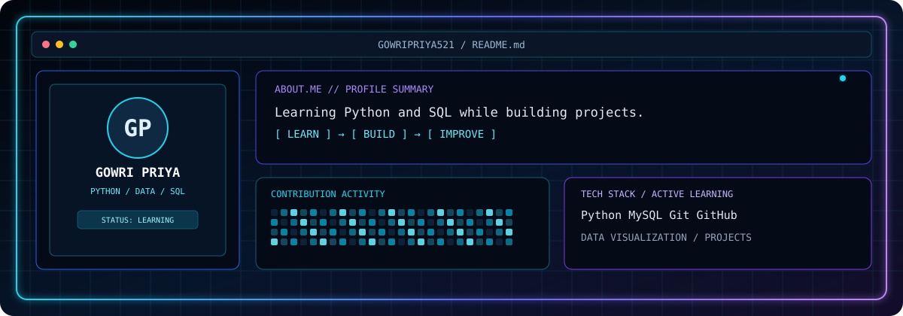
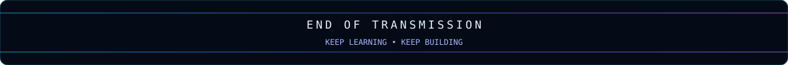

<div align="center">



# `GADDAM GOWRI PRIYA`
### Python • Data Analysis • SQL


<a href="https://in.linkedin.com/in/gaddamgowripriya"></a>
<a href="https://github.com/gowripriya521"></a>
<a href="https://www.python.org/"></a>
<a href="https://www.mysql.com/"></a>

</div>

---

## `01 PROFILE SYSTEM`

<table>
<tr>
<td width="32%" align="center" valign="middle">
  
  <br/><b>GOWRI PRIYA</b><br/>
  <sub>Python & Data Analysis Learner</sub>
  <br/><br/>
  
</td>
<td width="68%" valign="middle">

### `ABOUT.ME`

- 🌱 Beginner in Data Analysis, learning **Python and SQL**.
- 🧠 Practising programming concepts and building projects.
- 📊 Interested in data, charts, and useful applications.
- 🚀 Improving skills one project at a time.

```text
SYSTEM      : ONLINE
FOCUS       : PYTHON / SQL / DATA
MODE        : LEARN -> BUILD -> IMPROVE
```
</td>
</tr>
</table>

## `02 LIVE ANALYTICS`

<div align="center">
  
  
  <br/><br/>
  
</div>

## `03 TOOLCHAIN`

<div align="center">
  
  <br/><br/>
  
  
</div>

## `04 PROJECT ACCESS`

<div align="center">

<a href="https://github.com/gowripriya521?tab=repositories">

</a>

</div>

> Add individual project cards here as your repositories are ready to showcase.

<div align="center">
  
  <sub>BUILDING RELIABLE SKILLS • ONE COMMIT AT A TIME</sub>
</div>
