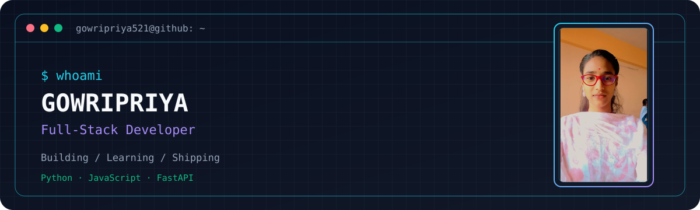

<div align="center">

<!-- Animated neon wave header -->


<!-- Typing animation -->
<a href="https://git.io/typing-svg">
  
</a>

<!-- Keep the existing personalized banner/photo frame -->


<p>
  
  
  
</p>

<p>
  <a href="https://github.com/gowripriya521"></a>
  <!-- Replace the LinkedIn URL below with your personal profile URL when ready. -->
  <a href="https://www.linkedin.com/"></a>
</p>

</div>

---

## `whoami` 

```python
class Gowripriya:
    role = "Developer"
    currently_learning = ["Python", "FastAPI", "Pydantic", "AI tools"]
    interests = ["Backend development", "APIs", "Automation"]
    motto = "Learn by building. Improve every day."
```

- 🌱 Currently strengthening my Python and backend development skills.
- 🔧 Practicing API development and data validation.
- 🎯 Goal: build useful projects and keep learning consistently.
- 💬 Explore my repositories to see what I'm working on.

## `tech_stack`

<div align="center">

**Languages**


**Frontend**


**Backend, databases & tools**


</div>

## `github_dashboard`

<div align="center">
  
  
</div>

<div align="center">
  
</div>

<div align="center">
  
</div>

## `contribution_activity`

<div align="center">
  <!-- Keep the dark/light picture block; the snake appears after GitHub Actions runs successfully. -->
  <picture>
    <source media="(prefers-color-scheme: dark)" srcset="https://raw.githubusercontent.com/gowripriya521/gowripriya521/output/github-contribution-grid-snake-dark.svg" />
    <source media="(prefers-color-scheme: light)" srcset="https://raw.githubusercontent.com/gowripriya521/gowripriya521/output/github-contribution-grid-snake.svg" />
    
  </picture>
</div>

## `featured_projects`

> Pin your strongest repositories on your GitHub profile. Add project cards here once you choose which repositories you want to highlight.

<div align="center">
  <a href="https://github.com/gowripriya521?tab=repositories"></a>
</div>

---

<div align="center">
  
  <code>while (learning) { build(); improve(); repeat(); }</code>
</div>
