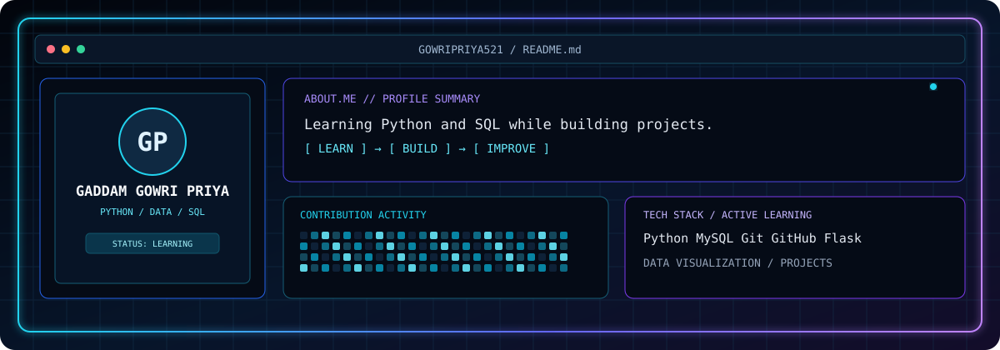

<div align="center">



<a href="https://github.com/gowripriya521">
  
</a>

</div>

---

### 🖥️ `SYSTEM.INFO` & Visual Terminal HUD

<table>
  <tr>
    <td width="55%" align="center" style="background:#0d1117; border: 1px solid #00ffcc;">
      <!-- Terminal Visual Box: Add your custom hero animation to assets/hero-terminal.gif -->
      
      <br/>
      <sub><b>[ VISUAL.MAP // PARTICLE HUD SCAN-LINE ]</b></sub>
    </td>
    <td width="45%" style="background:#0d1117; color:#00ffcc; font-family: monospace; font-size: 13px;">
      <pre style="background:transparent; border:none; color:#00ffcc;">
<span style="color:#38bdf8;">┌──[ gowripriya@system-hub ]──[~]</span>
<span style="color:#38bdf8;">└─$</span> ./display_profile.sh

<span style="color:#e2e8f0;">[SYSTEM.STATUS]</span>
  <b>User:</b>         Gowri Priya Gaddam
  <b>Role:</b>         Full Stack Developer
  <b>Origin:</b>       Madanapalle, AP, India
  <b>Education:</b>    B.Tech (CSE) @ Aditya College of Engg
  <b>Status:</b>       🟢 Open to Opportunities

<span style="color:#e2e8f0;">[CORE.SPECS]</span>
  <b>Core.Lang:</b>    Python, SQL
  <b>Core.Backend:</b> FastAPI, Flask
  <b>Core.DB:</b>      PostgreSQL, MySQL
  <b>Core.AI:</b>      Pydantic AI, Gemini API, LLMs
  <b>ToolChain:</b>    Git, VS Code, Postman, Docker

<span style="color:#e2e8f0;">[GRID.CHANNELS]</span>
  <b>Grid.Mail:</b>     gowripriyagaddam@gmail.com
  <b>Grid.LinkedIn:</b> /in/gaddamgowripriya
  <b>Grid.GitHub:</b>   /gowripriya521
      </pre>
    </td>
  </tr>
</table>

<div align="center">
  <a href="mailto:gowripriyagaddam@gmail.com">
    
  </a>
  <a href="https://www.linkedin.com/in/gaddamgowripriya">
    
  </a>
  <a href="https://github.com/gowripriya521">
    
  </a>
</div>


</div>

---

### 📊 Telemetry & Live Contributions

<div align="center">


<br/><br/>


#### 🐍 Activity Matrix (Contribution Grid)

<div align="center">
  
</div>

---

### 🛠️ Tech Stack & Architecture

<div align="center">

| Layer | Technologies & Ecosystem |
| :--- | :--- |
| **Languages** |  |
| **Backend & APIs** |  |
| **AI / ML & Agents** | `LLMs` `Pydantic AI` `Google Gemini API` `AI Agents` `Data Analysis` |
| **Tooling & Cloud** |  |

</div>

---

### 🧠 Domain Focus & Core Competencies

| Domain | Proficiency | Architectural Scope & Implementation |
|:---|:---:|:---|
| **Python** | Beginner–Intermediate | Data structures, modular script architecture, backend logic execution. |
| **SQL** | Beginner–Intermediate | Relational modeling, indexing, data hygiene, complex query joins. |
| **FastAPI** | Beginner | High-performance asynchronous RESTful APIs, Pydantic data validation schemas. |
| **Flask** | Beginner | Microservice route management, server-side templating, request pipelines. |
| **Pydantic AI** | Beginner | Structured output orchestration, tool-calling agent systems, workflow automation. |
| **LLMs & Gemini API** | Beginner | Prompt engineering, multi-turn system design, API integrations. |
| **Data Analysis** | Beginner | Exploratory data analysis, cleaning pipelines, summary metrics visualization. |

---

### 📂 Featured Implementations

<table>
  <tr>
    <td width="50%">
      <h3 align="center">🚀 Pydantic AI Intelligent Agent</h3>
      <p>Tool-calling assistant engineered with Python and Google Gemini API for structured schema parsing and automated workflow execution.</p>
      <p align="center">
        <code>Python</code> <code>Pydantic AI</code> <code>Gemini API</code>
      </p>
      <p align="center">
        <a href="https://github.com/gowripriya521"><b>View Source Code ➔</b></a>
      </p>
    </td>
    <td width="50%">
      <h3 align="center">⚡ Asynchronous REST API Suite</h3>
      <p>Performant CRUD backend built with FastAPI, PostgreSQL relational modeling, and automated Postman integration tests.</p>
      <p align="center">
        <code>FastAPI</code> <code>PostgreSQL</code> <code>Postman</code>
      </p>
      <p align="center">
        <a href="https://github.com/gowripriya521"><b>View Source Code ➔</b></a>
      </p>
    </td>
  </tr>
</table>

---

### 📡 System Connect

```bash
curl -s https://api.github.com/users/gowripriya521 | jq '{name, bio, location, hireable}'
```

<div align="center">
  <sub>Engineered by <b>Gowri Priya Gaddam</b> • Madanapalle, India</sub>
</div>
