<picture>
  <source media="(prefers-color-scheme: dark)" srcset="dark_mode.svg" />
  <source media="(prefers-color-scheme: light)" srcset="light_mode.svg" />
  
</picture>

<div align="center">
  
</div>

## About me
- **Gaddam Gowri Priya** — Full-Stack Developer
- **Education:** B.Tech
- **Location:** Bangulore, Madanapalle
- **Status:** Building · Learning · Shipping
- **Tools:** VS Code, Git, GitHub

## Tech stack
<p>&nbsp;&nbsp;&nbsp;&nbsp;&nbsp;&nbsp;&nbsp;&nbsp;&nbsp;&nbsp;</p>

## GitHub stats
Deploy your own `github-readme-stats` on Vercel using `SETUP.md`. Replace `YOUR-VERCEL-INSTANCE` below. Never put a token in this README.

<div align="center">

<br />


</div>

## Contribution snake
Add this block after the `Generate Snake Animation` workflow succeeds and creates the `output` branch.
```html
<picture>
  <source media="(prefers-color-scheme: dark)" srcset="https://raw.githubusercontent.com/gowripriya521/gowripriya521/output/github-snake-dark.svg" />
  <source media="(prefers-color-scheme: light)" srcset="https://raw.githubusercontent.com/gowripriya521/gowripriya521/output/github-snake.svg" />
  
</picture>
```

## Connect with me
<div align="center"><a href="https://www.linkedin.com/in/gaddamgowripriya/"></a>&nbsp;&nbsp;<a href="mailto:gowripriyagaddam@gmail.com"></a></div>
