  <picture>
    <source media="(prefers-color-scheme: dark)" srcset="dark.svg">
    <source media="(prefers-color-scheme: light)" srcset="light.svg">
    
  </picture>

<h1 align="center">Hi, I'm Gaddam Gowri Priya 👋</h1>

  <strong>Aspiring Full-Stack Developer | Python • SQL • Flask</strong> 
  Building, learning, and improving through practical projects.

---

## 👩‍💻 About Me

- 🎓 B.Tech in Computer Science and Engineering from Aditya College of Engineering.
- 🐍 Building my skills in Python, SQL, Flask, and REST API fundamentals.
- 📊 Interested in data analysis, backend development, and AI/ML applications.
- 💡 I enjoy learning by building practical projects and solving problems.
- 📍 Madanapalle, Andhra Pradesh, India.

## 🛠️ Technical Skills

| Area | Skills |
|---|---|
| Programming | Python, SQL |
| Python concepts | OOP, functions, exception handling, file handling, modules, decorators, APIs |
| Web & backend | Flask, REST API fundamentals |
| Database | SQL, SELECT, WHERE, GROUP BY, aggregate functions, JOINs, subqueries |
| Tools | Git, GitHub, VS Code, Jupyter Notebook, MS Excel (beginner) |
| Data & AI learning | Data analysis, data preprocessing, AI/ML fundamentals |

## 🚀 Projects

### AI-Driven Voice Authentication Locker
*Python · Flask · Voice Authentication · Face Authentication · OTP · Android*

- Developed a multi-step authentication project using voice, face, and OTP verification for locker access.
- Designed a fallback sequence: voice verification → face verification → OTP when an earlier check fails.
- Integrated the authentication workflow with an Android application.

### Online Payment Fraud Detection
*Python · Data Analysis · Machine Learning*

- Analysed online payment transaction data to explore patterns linked to potentially fraudulent transactions.
- Performed data preprocessing and exploratory analysis to support transaction classification.
- Explored ways to identify suspicious payment activity while considering the imbalance between genuine and fraudulent transactions.

### Employee Burnout Analysis
*Python · Data Analysis · Machine Learning*

- Processed employee-related data to explore patterns associated with workplace burnout.
- Examined relationships between employee attributes and burnout indicators.
- Used data analysis and machine learning techniques to identify factors associated with burnout risk.

---

## 📈 GitHub Contribution Activity

  

---

## 🤝 Connect With Me

  
  &nbsp;&nbsp;
  

  <em>Learning consistently • Building projects • Growing every day</em>

