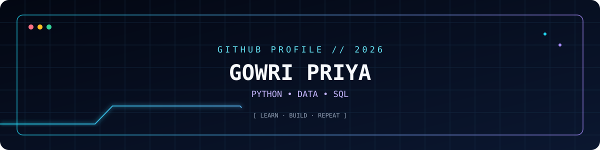

# Gowri Priya
### `Python Learner` · `Data Analysis` · `SQL`

---

## `01 / ABOUT ME`

- 🌱 Beginner in **Data Analysis**, learning Python and SQL.
- 🧩 Building projects and improving my programming skills.
- 📊 Interested in data, charts, and useful applications.
- 🎯 Goal: keep learning, practise consistently, and share projects here.

## `02 / TECH STACK`

  
    
  
  

## `03 / LIVE GITHUB ANALYTICS`

  
  
   
  
    
  
  

## `04 / CONTRIBUTION SNAKE`

  

## `05 / PROJECTS`

  

> New repositories and code changes will be reflected by GitHub's stats services after they refresh. Add individual project links here when you want to highlight specific projects.

---

  
  ✨ Learning every day · Building step by step ✨

